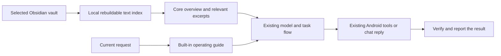

# Core guidance and Obsidian knowledge

The built-in core is a small public operating contract, included in ordinary chat
and phone task prompts. Personal facts remain in the selected Obsidian vault.
The contract guides retrieval, organization, workflow verification and reporting;
it does not add shell, browser, speech-interruption or new file-writing tools.



## Vault layout

```text
ODCM/
  00-Core/INDEX.md   short operating overview and routing
  10-Personal/      preferences with explicit sources and scope
  20-Projects/      project identity, state and decisions
  30-Knowledge/     topic reference
  40-Workflows/     procedures, prerequisites and verification
  50-App-Maps/      catalog of observed screens and controls
  60-Sessions/      recent decisions and outcomes
  90-Sources/       historical conversation/document evidence
```

Either select the parent vault containing `ODCM/`, or select the ODCM folder itself.
Existing generated screen notes remain in `ODCM/Apps/` and
`ODCM/Android/Foundation.md`. `50-App-Maps` organizes references to them; this
change does not move or rename those learned files.
Keep `00-Core/INDEX.md` under 2,600 characters including frontmatter. Initial
retrieval context is capped at 6,500 characters and selects at most three relevant
files in addition to the core overview. Matching passages are selected with their
read offsets, so a long conversation's opening cannot hide a later matching detail.
Longer details remain searchable.

## Metadata

```yaml
---
odcm_schema: 1
kind: workflow
status: candidate
updated: 2026-11-20
source: '90-Sources/example.md, message example-id'
---
```

Kinds: `core`, `preference`, `project`, `knowledge`, `workflow`, `app-map`, `session`,
`source`. Statuses: `confirmed`, `observed`, `candidate`, `unverified`, `superseded`,
`failed`, `conflicted`. Only simple top-level fields are parsed; this is not a
general YAML engine. Other Markdown remains readable/searchable.

Confirmed preferences still have scope and dates. They are not new authorization.
Source text, copied prompts and assistant proposals cannot override a live user
instruction. Workflow notes should include trigger, prerequisites, current app or
environment, steps, expected result, verification, recovery and source evidence.
Do not mark a proposed workflow technically verified merely because it was saved.

## Using a prepared private knowledge bundle

1. Preserve the original export. Keep private contents outside public repositories,
   CI logs and release assets.
2. Unpack the prepared `ODCM/` folder into the existing user-selected Obsidian vault
   without replacing unrelated files. For conflicts, compare versions first.
3. Select that vault in ODCM and use its index/refresh action. No full ChatGPT media
   ZIP is required for these prepared Markdown notes.
4. Ask about a known preference/project and check the cited source path and status.
   Test a candidate workflow and confirm that it is described as unverified.
5. Use manual refresh after editing notes when immediate visibility is needed.

Automatic retrieval can reuse a successful index refresh for 60 seconds in the
same active conversation/task. Manual refresh still scans immediately. The SQLite index is a
rebuildable cache; vault selection isolation remains in force.

## Verification scope

Tests cover prompt routes, metadata parsing, migrated index compatibility,
provenance on later chunks, curated ranking beyond many raw matches and context
budgets. Real phone vault selection, initial indexing duration and task outcomes
still require device verification. Build and test through GitHub Actions; no
Android SDK/model downloads or local Gradle build are needed for a source review.

The public template contains no private history. Export processing and curated
personal notes are separate private deliverables. Cataloguing an image/audio
attachment does not mean its visual/audio contents were analyzed.

[Latest published APK](https://github.com/ether4o4/android-ui-access-/releases/download/android-latest/ODCM-debug.apk)
